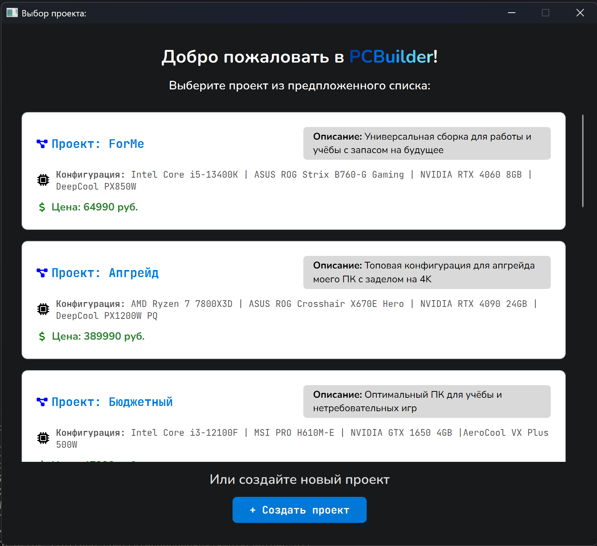
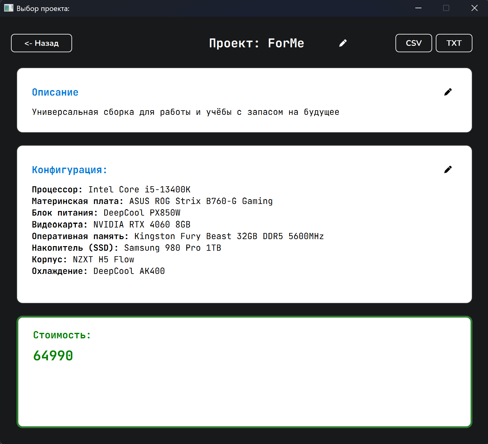

# 🖥️ PC Builder

Современное кроссплатформенное десктопное приложение для просмотра, управления и экспорта конфигураций сборок ПК. Разработано на **Python** с использованием фреймворка **PyQt6**.

Приложение отличается чистым кодом, модульной архитектурой, тёмной темой оформления и удобными горячими клавишами.


---

## ✨ Возможности

- 📋 **Каталог сборок**: Удобный список проектов с краткой информацией и прокруткой.
- 🔍 **Детальный просмотр**: Полная информация о конфигурации (CPU, GPU, RAM, SSD, корпус, охлаждение, БП) и стоимости.
- 💾 **Экспорт данных**: Сохранение конфигурации проекта в форматы **CSV**, **TXT** или **PDF**.
- ✏️ **Редактирование**: Встроенный кастомный диалог для изменения описания и конфигурации с валидацией.
- ⌨️ **Горячие клавиши**: 
  - `Ctrl + Enter` или `Ctrl + S` — сохранить изменения в диалоге.
  - `Esc` — закрыть диалог без сохранения.
- 🎨 **Современный UI**: Тёмная тема, кастомные шрифты (*Nunito* для интерфейса, *JetBrains Mono* для технических данных) и векторные иконки через `QtAwesome`.
- ⚡ **Быстрая работа**: Использование `ProjectManager` с кэшированием данных в памяти для мгновенного доступа к `projects.json`.

---

## 📸 Скриншоты

| Список проектов | Детальная страница |
| :---: | :---: |
|  |  |

---

## 🛠️ Стек технологий

- **Язык**: Python 3.10+
- **GUI**: PyQt6
- **Иконки**: QtAwesome
- **Хранение данных**: JSON (с кэшированием в памяти)

---

## 🚀 Установка и запуск

1. **Склонируйте репозиторий**:
   ```bash
   git clone https://github.com/tylerderden9681-wq/PcBuilder.git
   cd PcBuilder